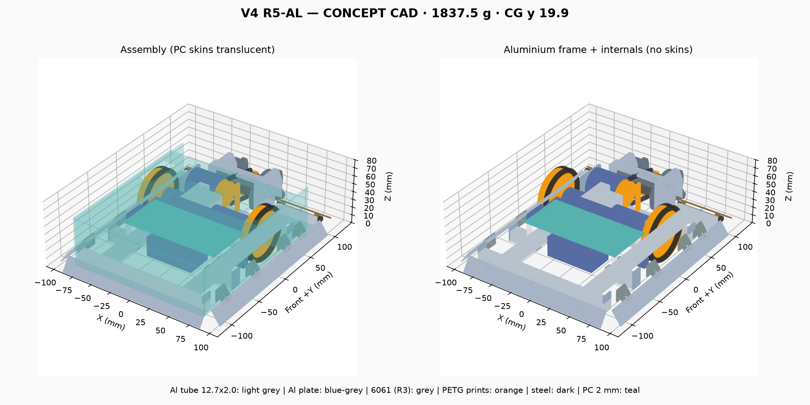

# Robot V4 R5-AL — โครงอะลูมิเนียม ไม่มีชิ้นกลึง (27 ต.ค. 2026)

**สถานะ:** CONCEPT_CAD ยังไม่ใช่ไฟล์ผลิต · แกน +Z ขึ้น หัวรถ +Y หน่วย มม. (AGENTS.md) · ไม่ได้แก้ r3/, r4_steel/ หรือ r4_diy/

ทำตามที่ผู้ใช้กำหนด (27 ต.ค.):
- **ใช้อะลูมิเนียมแทนเหล็ก** ใช้เหล็กเฉพาะจุดที่การคำนวณบอกว่าจำเป็น และใช้สเตนเลสเฉพาะจุดที่ตรวจแล้วว่าดีกว่า
- **ไม่มีชิ้นที่ต้องกลึงเลย** ชิ้นที่เคยกลึงเปลี่ยนเป็นชิ้นพิมพ์ 3D หรือของที่หาซื้อได้

ไฟล์และวิธีรัน:
- สร้าง CAD: `.venv-v4-print/bin/python robot_v4/print_revision/r5_al/build_r5_al.py` → `output/`
- คำนวณ: `python3 robot_v4/print_revision/r5_al/calc/r5_al_calc.py` → `calc/r5_al_calc.json`

## 1. ผลสรุป

| | R4-DIY (เหล็กเชื่อม) | **R5-AL** |
|---|---|---|
| น้ำหนัก | 1,980 g | **1,837.5 g (เบาลง 142 g, เหลือเผื่อถึง 2 กก. 162 g)** |
| ชิ้นที่ต้องกลึง | 7 | **0** |
| การต่อโครง | เชื่อมไฟฟ้า | ยึดด้วยน็อต M3/M4 + rivnut |
| พลังงานอาวุธ (ใช้งานจริง) | 57.4 J | **61.1 J** (ท่อเหล็กหนักกว่าดุมเดิมเล็กน้อย และรอบเพิ่ม 1.1%) |
| แรงดัน 2WD ที่ μ 0.6 | 7.7 N | 7.85 N |
| ผนังข้าง PC แอ่นเมื่อ skirt โดนดัน | 7.5 มม. ❌ (SF 0.4) | **1.5 มม. ✅ (SF 2.0)** |
| SF ต่ำสุดในกรณีออกแบบ (2.6 kN) | 2.03 | **2.01** |

**ผลตรวจ CAD**
- ชิ้นส่วนชนกัน **0** จุด
- ไม่มีชิ้นโครงที่ลอยไม่ติดกับชิ้นอื่น
- ใบหมุนครบรอบโดยไม่ชนอะไร
- wedgelet แกว่งได้ −20…+15° ผ่านเกณฑ์ −2…+14°
- STEP ที่ส่งออกแล้วเปิดกลับมาได้ขอบเขตตรงกัน: X ±102.9, Y −124.9…128.0, Z 0…64

## 2. วัสดุแต่ละชิ้น (เหตุผลและตัวเลขที่ใช้ตัดสินอยู่ใน `materials` ของ r5_al_calc.json)

| ชิ้น | R4-DIY | **R5-AL** | เหตุผล |
|---|---|---|---|
| ท่อโครง | เหล็ก SS400 12×12×1.2 เชื่อม | **อะลูมิเนียม 12.7×12.7×2.0 ยึดน็อต** เกรด **6063-T6 ขึ้นไป** (6061-T6 ดีที่สุด) | ท่อเบากว่าเหล็กต่อความยาว 43% เกรด 6063-T5 ที่ขายทั่วไปแบบงานหน้าต่าง**ไม่ผ่าน**กรณีตรวจ 5.2 kN (SF 0.78) ส่วน T6 ได้ SF 1.20 และ 6061-T6 ได้ 1.70 |
| แผ่นยึด/ฉาก | เหล็ก 1.6 เชื่อม | อะลูมิเนียม 5052/6061 หนา 2.0 ยึดน็อต | น็อต M3 หนึ่งตัวรับแรงกดในผนังอะลูมิเนียม 2 มม. ได้ประมาณ 1–2 kN |
| แผ่นตั้งยึดเพลาอาวุธ / brace / ฐานมอเตอร์อาวุธ | เหล็ก 3.2 / 1.6 / 2.3 เชื่อม | **6061 หนา 6 / 3 / 3 มม. ของ R3** (ยึดน็อต) | ใช้ชิ้นของ R3 ที่ออกแบบและตรวจแล้ว จึงไม่ต้องเชื่อมอะลูมิเนียม |
| จานอาวุธ | SS400 6 มม. | **เหล็ก (คงเดิม)** SS400 หรือ Hardox | อาวุธต้องหนักจึงเก็บพลังงานได้ สเตนเลส 304 อ่อนกว่า (ประมาณ HB 200 เทียบ Hardox ที่ 450) ฟันจะสึกเร็ว |
| ดุมอาวุธ | 6061 ต้องกลึง | **ท่อเหล็กดำ 3/4" (OD 26.7 หนา 2.3) ยาว 40 มม. เชื่อมติดจาน** | ดุมพิมพ์ 3D รับไม่ไหว (ดูข้อ 4) และเชื่อมอะลูมิเนียมเข้ากับจานเหล็กไม่ได้ ท่อเหล็กหาซื้อได้ทั่วไป |
| เพลา M8 (ไม่หมุน) | 12.9 | **เหล็ก 12.9 (คงเดิม)** | ความเค้นดัด 660 MPa: เกรด 12.9 ได้ SF 1.64 ส่วนสเตนเลส A4-80 ได้ **0.91 ซึ่งไม่ผ่าน** สเตนเลสจึงแย่กว่า |
| wedgelet | SS400 1.6 | **เหล็ก SS400 1.6 (คงเดิม)** หรือสเตนเลส 304 หนา 1.5 ถ้าหาได้ | ต้องการขอบบางที่แข็ง อะลูมิเนียม 5052 หนา 1.6 จะบุบและขอบม้วน ส่วน 304 แข็งแรงพอกันและไม่เป็นสนิม |
| หมุดบานพับ wedgelet | M3 เกรด 8.8 | **สเตนเลส A2-70** | รับแรงเฉือนได้ 2.1 kN เทียบ 8.8 ที่ 2.4 kN แต่แรงจริงไม่ถึง 0.5 kN สเตนเลสจึงดีกว่าเพราะจุดหมุนไม่เป็นสนิม |
| สกรูยึดผนังและ skirt | เหล็กชุบซิงค์ | **สเตนเลส A2** | แรงน้อย และไม่เป็นสนิม |
| spacer เพลา, พูลเลย์มอเตอร์, ดุมล้อ | 6061 ต้องกลึง | **พิมพ์ PETG เนื้อเต็ม 100%** (พูลเลย์ใช้ ASA ถ้ามอเตอร์ร้อน) | ดูข้อ 4 |
| ผนังและฝา | PC 2 มม. | PC 2 มม. (คงเดิม) | เพิ่มจุดยึดกลางผนังแก้ปัญหาผนังแอ่นแล้ว |

## 3. รอยเชื่อมที่เปลี่ยนเป็นจุดยึดน็อต

**แผ่นตั้งยึดเพลาอาวุธ → โครง** (ข้างละ 4 × M4 เกรด 8.8)
- ยึดผ่านท่อเชื่อมอะลูมิเนียม 12.7 ที่ต่อจากแผ่นตั้งไปคานข้าง ใช้ 2 ตัว
- ยึดผ่านฉากอะลูมิเนียม 2 มม. ที่ต่อเข้าคานขวาง ใช้ 2 ตัว และต๊าปเกลียว M4 ในแผ่นตั้ง 6061
- ตัวที่รับแรงมากที่สุดได้ SF **3.45–4.07** ในกรณีออกแบบ และ **1.73–2.04** ในกรณีตรวจ
- ตอนแรกลองใช้ 3 × M3 ได้แค่ SF 1.35 ต่ำกว่าเกณฑ์ 1.5 จึงเปลี่ยนเป็น M4

**มุมโครง (คานข้าง → คานขวาง)**
- ใช้ฉากอะลูมิเนียม 20×20×2 (cleat) 2 ชิ้น แต่ละชิ้นยึด M3 2 ตัว ได้ SF 6.1 ในกรณีออกแบบ และ 3.0 ในกรณีตรวจ

**ฐานมอเตอร์อาวุธ (M06)**
- วางบนฉากอะลูมิเนียม 2 ชิ้นที่ยึดกับคานข้างและคานขวาง กรณีตกจากความสูง 0.5 ม. ได้ SF 15

**ฉาก cleat และ rivnut ทุกจุด** นับเป็นน้ำหนักเผื่อไว้แล้ว 164 g แต่ยังไม่ได้วาดเป็นรูปทรงใน CAD

## 4. ชิ้นที่เคยต้องกลึง

| ชิ้นเดิม | เปลี่ยนเป็น | ผลตรวจ |
|---|---|---|
| ดุมอาวุธ 6061 | **ท่อเหล็กดำ 3/4" เชื่อมติดจานทั้งสองใบ** ลูกปืน 608 อยู่ในปลายท่อ ยึดด้วยน้ำยาล็อกลูกปืน สายพานวิ่งบนผิวท่อ โดยมีปีกกันหลุด PETG สองวง | ท่อรับแรงบิด 122 N·m (ครึ่งหนึ่งของแรงบิดตอนฟันโดนตี) ได้ SF 2.21 ส่วนรอยเชื่อมรอบท่อได้ SF 3.71 |
| ทำไมดุมพิมพ์ใช้ไม่ได้ | แกน PETG ต้องรับแรงบิดประมาณ 122 N·m จะเกิดความเค้นบิด 24 MPa ใกล้ขีดที่ PETG รับได้ประมาณ 30 MPa ถ้าใช้น็อต M4 ร้อยข้ามช่อง 40 มม. น็อตจะงอ (ต้องรับโมเมนต์ประมาณ 47 N·m แต่น็อตรับได้แค่ 3.6 N·m) | — |
| spacer เพลา 3 ชิ้น | พิมพ์ PETG เนื้อเต็ม 100% และ**ขันน็อตแค่พอแน่น** (แรงกดไม่เกิน 300 N) | ถ้าโดนตีด้านข้าง 520 N spacer รับความเค้น 12.7 MPa ได้ SF 4.3 |
| พูลเลย์มอเตอร์ D30 | พิมพ์ PETG หรือ ASA ยึดเพลาด้วยสกรูตัวหนอน M3 ขันลงบนผิวเพลาที่ตะไบให้เรียบ | แรงบิดสูงสุดของมอเตอร์ 0.31 N·m ได้ SF 3.3 ถ้ามอเตอร์ร้อนเกิน 60°C ให้ใช้ ASA หรือ PETG-CF |
| ดุมล้อ 6061 + โอริง | พิมพ์ PETG เนื้อเต็ม 100% ผนังกลางหนา 3 มม. ใช้โอริงยาง P52 ตัวเดิม | รูเพลารูป D รับแรงได้ SF 25 |

**ต้องวัดก่อนซื้อ:** รูในของท่อ 3/4" ต้องได้ 22.0–22.15 มม. เพื่อให้ลูกปืน 608 สวมได้ ความหนาท่อแต่ละรุ่นไม่เท่ากัน จึงต้องวัดด้วยเวอร์เนียที่ร้าน หลังเชื่อมจานติดท่อแล้วต้องถ่วงสมดุลก่อนใช้

## 5. แก้ปัญหาที่ค้างจาก R4-DIY

1. **ผนังข้างแอ่น:** เพิ่มท่ออะลูมิเนียมสั้นพร้อมแผ่นยึด ที่ y −55 ทั้งสองข้าง ระยะระหว่างจุดยึดเหลือ 40 และ 92 มม. ผนังแอ่นแค่ 1.5 มม. **ผ่านเกณฑ์** (ตำแหน่งนี้เลี่ยงสวิตช์ไฟที่ y −30)
2. **คานข้างตรงคานขวาง:** ถ้าใช้ 6063-T6 กรณีออกแบบได้ SF 2.41 กรณีตรวจทิศไปหน้า-หลังได้ 1.20 ส่วนกรณีตรวจทิศ "ดันขึ้น" ได้ 0.78 ซึ่งเป็นทิศที่ใบหมุนแบบนี้สร้างแรงไม่ได้จริง (R4 ได้ 0.74 ในกรณีเดียวกัน) ถ้าอยากให้ผ่านทุกกรณีให้ใช้ 6061-T6 ซึ่งได้ 1.10
3. **น้ำหนัก:** 1,837.5 g ผ่านเป้า 1,950 g แล้ว เหลือเผื่อ 112 g

## 6. สิ่งที่ยังค้าง

- **ยังไม่ได้วาดฉาก cleat และ rivnut** ตามมุมโครงใน CAD นับไว้เป็นน้ำหนักแล้วเท่านั้น
- **ต้องเช็กว่าร้านมีท่ออะลูมิเนียม 12.7×12.7×2.0 เกรด T6** ถ้าหาได้แค่ T5 ต้องเพิ่มแท่งอะลูมิเนียมตันเสริมในคานข้างตรงคานขวาง หรือเปลี่ยนไปใช้ 6061-T6
- **แผ่นยางรองมอเตอร์ขับบางลงเหลือ 0.8 มม.** (เดิม 1.5) เพราะท่อสูงขึ้น 0.7 มม.
- **ยังไม่ได้ทำแบบตัด** (cut list, DXF, PDF แบบ 1:1) ของ R5-AL
- **V5 ยังใช้เหล็กอยู่** ถ้าจะทำตามกฎวัสดุใหม่ ต้องแปลงแบบเดียวกันนี้
