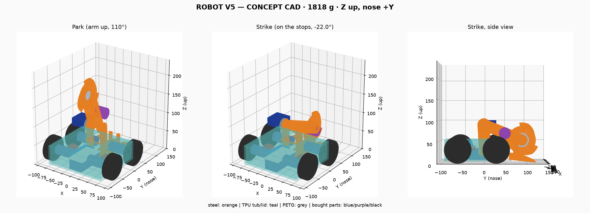

# ROBOT V5 — แนวคิดสไตล์ SawBlaze (27 ต.ค. 2026)

**สถานะ:** มี CONCEPT CAD แบบลดงบแล้ว (ข้อ 10) แต่ยังไม่ได้ปล่อยไฟล์ผลิต ยังไม่ได้ซื้ออะไหล่ ตัวเลขที่เขียนว่า ASSUMED ต้องวัดหรือหาราคาจริงก่อน
ผู้ใช้ตัดสินใจ 27 ต.ค.: **สร้าง V5 เพิ่มจาก V4** และให้ลดงบ V5 (ข้อ 9)

ไฟล์ที่เกี่ยวข้อง:
- [`design_v5.py`](design_v5.py) → `v5_design.json`: การคำนวณหลัก
- [`budget_cuts_v5.py`](budget_cuts_v5.py) → `budget_cuts_v5.json`: การลดงบ
- [`cad/build_v5.py`](cad/build_v5.py) → `cad/output/`: CAD

**ลำดับการรัน:** สร้าง CAD ก่อน แล้วรัน `design_v5.py` จากนั้น `budget_cuts_v5.py` เพราะ `design_v5.py` อ่านค่ามวล ความเฉื่อย และคานการพลิกตัวกลับที่วัดจาก CAD (`cad/output/v5_cad_props.json`)
แกน: Z ขึ้น หน้า +Y แบบเดียวกับ V4

SawBlaze ตัวจริงหนักประมาณ 113 กก. จึง**ใช้จากไฟล์ FBX แค่สัดส่วนของ layout** ส่วนขนาดชิ้นส่วนทุกชิ้นเลือกจากอะไหล่จริงของหุ่น 1–2 กก.

## 1. ผลหลัก: พลังทำลายเทียบ V4

| อาวุธ | พลังงานที่**เก็บไว้** | เทียบ V4 (57 J) | ความลึกที่ฟันกินต่อซี่ |
|---|---|---|---|
| **ค้อน (แขนฟาดลง)** ด้วยเซอร์โว | **0.34 J** | 0.006× | — |
| เลื่อย A: ใบตัด TCT 85 มม. 24 ฟัน | 29.5 J ที่ 10,000 rpm | 0.51× | 0.25 มม. |
| **เลื่อย B: จานเหล็ก 3 มม. Ø85, 3 ฟัน** (วัดจาก CAD) | **69 J** ที่ 12,500 rpm | **1.20×** | **1.6 มม.** |
| V4 beater (อ้างอิง) | 57 J | 1.00× | 4.8 มม. ที่ 2 m/s |

ความลึกที่ฟันกินในตารางคิดที่แขนกดลงด้วยความเร็ว 1 m/s

สรุปจากตาราง:
- **การฟาดของแขนแทบไม่มีพลังทำลาย** เซอร์โวหมุนได้ช้า ความเสียหายทั้งหมดมาจากจาน
- **จาน B เก็บพลังงานได้ 69 J ไม่ใช่ 106 J ตามที่ประมาณไว้ก่อน** ค่าแรกคิดเป็นวงแหวนเต็ม แต่จานจริงมีร่องระหว่างฟันที่ตัดขอบนอกออก และโมเมนต์ความเฉื่อยโตตามรัศมีกำลังสี่ CAD วัดได้ 8.07×10⁻⁵ kg·m² (รวมดุม) ซึ่งยังเก็บพลังงานได้มากกว่า V4 ประมาณ 1.2 เท่า
- **ข้อแม้:** แขนมีมวลหนุนที่หน้าจานแค่ 0.12 กก. ขณะที่ V4 มีทั้งตัวรถ 1.9 กก. หนุนอยู่ พลังงานจะถึงคู่แข่งได้ก็ต่อเมื่อแขนวางลงบนตัวกัน (hard stop) และจานหมุนในทิศที่ถูก (ดูข้อ 3)

## 2. สัดส่วนจาก SawBlaze → V5 (กว้าง 200 มม.)

| ส่วน | สัดส่วน/ความกว้างรวม | คิดที่กว้าง 200 มม. | V5 ใน CAD | เหตุผล |
|---|---|---|---|---|
| ความกว้างรวม | 1.00 | 200 | 192 (ขอบนอกล้อ) | |
| ความกว้างตัวถัง | 0.754 | 151 | 154 | |
| เส้นผ่านศูนย์กลางล้อ | 0.234 | 47 | **64** | ใช้ล้อแบบ V4 |
| แกนหมุนแขนถึงใบ | 0.483 | 97 | 100 | |
| ความสูงแกนหมุนแขน | 0.264 | 53 | **90** | ต้องสูงขนาดนี้ แขนจึงพ้นฝาในท่าฟาด |
| เส้นผ่านศูนย์กลางใบ | 0.347 | 69 | 85 | |

SawBlaze ตัวจริงใช้ 2 ล้อ แต่ V5 คำนวณแล้วว่าควรใช้ **4WD** (ดูข้อ 4)

## 3. แขน เซอร์โว และการส่งพลังงาน (ค่าแขนวัดจาก CAD)

| เซอร์โว | ค้ำแขนในแนวนอน | พลิกตัวกลับ | ฟาด 132° | ราคา |
|---|---|---|---|---|
| **DS3218 19 kg·cm ที่ 5 V** (ไฟจาก BEC ของ SkyWalker 30A) | 7.4× | **2.6×** (เทียบ clutch 1.3 N·m: **1.85×**) | 0.29 s | **735** (ราคาจริง) |
| DS3235SG 35 kg·cm | 14× | 4.7× | 0.21 s | 650 |
| DS5160 60 kg·cm | 24× | 7.7× | 0.23 s | 1,100 |

- ตัวเลขค้ำแขนและพลิกตัวกลับคือ margin หรือจำนวนเท่าของแรงบิดที่ต้องใช้ ราคาเป็นบาท (ASSUMED)
- **การพลิกตัวกลับคำนวณจาก CAD:**
  - หุ่นที่คว่ำอยู่วางบนหัวเซอร์โวกับขอบหลังของฝา จานแตะพื้นเมื่อแขนกางขึ้นได้ 14°
  - จากนั้นจำลองการพลิกทีละ 2° จนจุดศูนย์ถ่วงพ้นขอบหลังที่ประมาณ 50° แรงบิดสูงสุดคือ **0.70 N·m** ซึ่งเกิดตอนจานเริ่มแตะพื้น แล้วค่อย ๆ ลดลง
- **slip clutch เป็นตัวจำกัดแรงบิดที่แขนได้รับ ไม่ใช่เซอร์โว** ตั้ง clutch ให้เริ่มลื่นที่ 1.3 N·m จะได้ margin การพลิกตัวกลับ **1.85×** ซึ่งเกินเกณฑ์ 1.5× ส่วน margin 2.7× ในตารางคิดเทียบแรงบิดสูงสุดของเซอร์โว
- **เลือก DS3218** เพราะเซอร์โวที่แรงกว่าไม่ได้ทำให้ฟาดแรงขึ้น และ clutch จำกัดแรงบิดอยู่แล้ว
- **ต้องใส่ slip clutch** ถ้าโดนตีที่ใบ แรงบิดที่ส่งถึงแกนแขนประมาณ 830 N·m เฟืองเซอร์โวรับไม่ได้
- **ทิศหมุนของจาน:** ให้หมุนรอบแกน +X ตามกฎมือขวา คือฟันด้านหน้าวิ่งขึ้น แรงสะท้อนกลับจะกดแขนลงบนตัวกัน

**ตัวกันแขน (hard stop) ต้องอยู่ใต้แกนจาน ห้ามอยู่ใกล้แกนหมุนแขน**

CAD รุ่นแรกวางเสากันไว้ที่ระยะ 29 มม. จากแกนหมุน บนแขนยาว 100 มม. แขนจึงกลายเป็นคาน ผลที่ได้คือ:
- เสารับแรง 3.4 เท่าของแรงตี
- แกนหมุนโดนดึงขึ้น 2.4 เท่า
- แผ่นแขนรับความเค้นเกินจุดคราก (yield) หลายเท่า

CAD ตอนนี้จึงย้ายเสาไปไว้ใต้แกนจาน (ระยะ 90 มม. จากแกนหมุน) เสาทำจากเหล็กแบน 3.2×12 ตั้งบน**ลิ้นเหล็กหน้ารถ (nose tongue)** ที่วางบน skid UHMW ทำให้แรงตีลงพื้นสนามโดยตรง

ผลคำนวณที่ 69 J (โมเดลแรงกระแทก 1 ms แบบ V4 ได้แรงสูงสุด 9.1 kN):

| จุด | แรง / ความเค้น | SF |
|---|---|---|
| เสากันแขน 2 ต้น | ต้นละ 5.1 kN, 132 MPa | โก่งเดาะ 2.24, คราก 1.85 |
| แกนหมุนแขน (608 ×2) | ตัวละ 0.53 kN | 2.6 (เทียบ C0) |
| แผ่นแขนตรงเสา (2.3 มม.) | 169 MPa | 1.45 |
| เพลาจาน M8 | 588 MPa | 12.9: 1.84 / 8.8: 1.09 → **ต้องใช้ 12.9** |
| ลูกปืน 608 ในดุมจาน | ตัวละ 4.5 kN | เกิน C0 3.3 เท่า (V4 เกิน 3.0 เท่า) ถือเป็นของสิ้นเปลือง |

- **แขนรอดจากการโดนตีได้ถึงประมาณ 144 J** โดยทุกจุดยังมี SF ≥ 1
- ถ้าใช้แผ่นแขน 1.6 มม. SF จะเหลือ 1.01 จึงเปลี่ยนเป็น **2.3 มม.**
- เสากันรับได้แค่แรงที่กดแขนลง ถ้าโดนตีจากด้านล่างจนแขนดีดขึ้น clutch จะลื่นแทน
- **ผลของ gyro:** จำกัดอัตราเลี้ยวไว้ไม่เกิน **12.2 rad/s** ไม่อย่างนั้นล้อด้านหนึ่งจะยก ส่วนตอนแขนฟาดไม่มีแรงบิดจาก gyro เพราะแขนหมุนรอบแกนเดียวกับจาน

## 4. ระบบขับ

| | 4WD (งาแบบบานพับ) | 2WD (งาแข็งลากพื้น แบบ SawBlaze) |
|---|---|---|
| แรงดัน μ 0.4 / 0.6 / 0.8 | **7.1 / 10.8 / 14.0 N** | 3.8 / 6.1 / 6.2 N |
| เทียบ V4 (7.4 / 11.1 / 14.1 N) | เท่ากัน | ได้ประมาณครึ่งเดียว |

**เลือก 4WD** ใช้มอเตอร์ JGA25-370 และล้อแบบ V4
- ใน CAD ล้อติดไว้นอกตัวถัง ระยะระหว่างเพลาหน้า-หลัง 90 มม.
- CG อยู่ระหว่างเพลาทั้งในท่าเก็บแขนและท่าฟาด (ข้อ 10) จึงไม่มีปัญหาหัวหนักแบบ V4

## 5. งาหน้า

แบบตั้งต้นใช้ 65Mn 12×3 มม. วางแบน ส่วน CAD ใช้แบบลดงบ คือเหล็กแบน 12×4 **ตั้งสัน** (ข้อ 9–10)

| กรณีโหลด | 65Mn 12×3 วางแบน | **เหล็กเหนียว 12×4 ตั้งสัน** |
|---|---|---|
| คู่แข่ง 2 กก. ทับปลาย ×3g | SF 3.4 | SF 6.4 |
| หุ่นเราตกลงบนปลายงา ×5g | SF 2.2 | **SF 4.1** |
| ดันด้านข้าง 30 N ที่ปลาย | — | SF 4.2 |

- งาทุกแบบต้องเป็นบานพับ ถ้าโดนตีจากด้านล่าง งาจะพับขึ้นแทนการงอ
- งาแข็งยึดตายโดนตีแค่ 2 J ก็งอ (SF 0.46 แม้ใช้ 65Mn)

## 6. น้ำหนักและงบ (แบบเต็มราคาก่อนลดงบ: จาน B + DS3218 + 4WD)

- น้ำหนักประมาณการ 1,879 g ส่วน CAD วัดได้ **1,818 g** (ข้อ 10)
- งบเต็มราคา 6,442 บาท ถ้าต้องซื้อ ESP32 กับที่ชาร์จ หรือ 5,622 บาท ถ้ามีอยู่แล้ว
- **ผู้ใช้ยืนยัน 27 ต.ค. ว่ามี ESP32 กับที่ชาร์จแล้ว** (ข้อมูลใน STATUS.md วันที่ 8 ต.ค. ที่บอกว่ายังไม่มีบอร์ดจึงเป็นข้อมูลเก่า) ผู้ใช้มี ESP32 สองตัว จึงใช้กับ V4 และ V5 ได้ตัวละตัว ส่วนที่ชาร์จใช้เครื่องเดียวกัน V5 จึงไม่ต้องซื้อทั้งสองอย่าง
- แบบลดงบที่ใช้สร้างจริงอยู่ในข้อ 9

## 7. คัดกรองคู่ต่อสู้ (เทียบ V4 แบบเงื่อนไขเดียวกัน)

ใช้โมเดลเดียวกับ `robot_v4/matchup_screen.py` สุ่ม 50,000 รอบ กำหนดแรงดัน 6.2–12.4 N และขอบงาสูงจากพื้น 0.5–1.5 มม. เท่ากับ V4

| คู่ต่อสู้ | งาอยู่ใต้คู่แข่ง V5 / V4 | คู่แข่งมุดใต้เรา V5 / V4 | ชนะการดัน V5 / V4 | พลังงานมากกว่าคู่แข่ง V5 / V4 |
|---|---|---|---|---|
| V2 robot2 | 0.81 / 0.83 | 0.90 / 0.92 | 0.63 / 0.63 | — |
| R3 | 0.43 / 0.58 | 0.42 / 0.58 | 0.45 / 0.46 | — |
| wedge ต่ำทั่วไป | 0.63 / 0.74 | 0.26 / 0.36 | 0.41 / 0.41 | — |
| spinner แนวนอน | 1.00 / 1.00 | 0.00 / 0.00 | 0.87 / 0.88 | **0.27 / 0.16** |
| spinner แนวตั้ง | 0.94 / 0.96 | 0.40 / 0.43 | 0.77 / 0.77 | **0.44 / 0.30** |
| pusher ไม่มีอาวุธ | 0.87 / 0.92 | 0.08 / 0.12 | 0.07 / 0.08 | — |

ข้อสรุปและข้อจำกัด:
- การเข้าใต้คู่แข่งและการดันของ V5 ใกล้เคียง V4 ส่วนพลังงานเมื่อเจอ spinner ดีกว่า V4 เล็กน้อย
- V5 ต้องดันคู่แข่งขึ้นงาก่อน แล้วใช้เวลาฟาดลงอีกประมาณ 0.24 s ซึ่งโมเดลนี้ยังไม่ได้คิด

## 8. สิ่งที่ต้องทำต่อ

1. ~~ยืนยันว่ามี ESP32 กับที่ชาร์จแล้วหรือยัง~~ ยืนยันแล้ว 27 ต.ค. ว่ามี ใช้กับ V4
2. ~~หาราคาจริง~~ หาแล้ว 27 ต.ค. (ข้อ 9) ที่เหลือคือยืนยันกับร้าน: KV ของมอเตอร์ ABC 2212, สเปก 30A/40A ของ SkyWalker และราคาเศษเหล็ก 2.3/1.6/3.2 มม.
3. ออกแบบ slip clutch และวิธีต่อจากเซอร์โวเข้าแขนให้ละเอียด (ใน CAD ยังเป็นแค่กล่องแทนรูปทรงคร่าว ๆ)
4. จำลองแบบ MuJoCo เพื่อดูลำดับดันขึ้นงาแล้วฟาด และดูว่าแขนเด้งหรือไม่

## 9. ลดงบเพื่อสร้าง V5 เพิ่มจาก V4

### ลดได้ (รวม 1,442 บาท ตามราคาจริง 27 ต.ค.)

| ลด | ประหยัด | น้ำหนัก | สิ่งที่เสีย |
|---|---|---|---|
| มอเตอร์จาน D3536 + Skywalker 40A → **มอเตอร์ 2212 1400kV (320) + Hobbywing SkyWalker 30A V2 UBEC (400)** สายพานทด 0.9 | **330** | −44 g | พลังงาน 70 J (เดิม 69) เร่งจานถึง 90% ใน 0.44 s (เดิม 0.33) แต่ A2212 รับกระแสต่อเนื่องได้ประมาณ 15–20 A ตอนเร่งจาน 30 A จะเกินพิกัดชั่วครู่ |
| แขน + ตัวยึดแกนแขน 6061 CNC → **เหล็กตัดแล้วเชื่อมเอง** (แขน 2.3 มม., เสาค้ำแกนแขน/ลิ้น 1.6 มม., เสากัน 3.2) และเพิ่ม skid UHMW (40 บาท) | **460** | +89 g | แขนแข็งขึ้น 2.2× เทียบ 6061 3 มม. ถ้าโดนตี 69 J แขนรับ 169 MPa (SF 1.45) |
| งา 65Mn ตัดเลเซอร์ → **เหล็กแบน 1/2" × 4 มม. ตั้งสัน** (ซื้อเส้นยาว 6 ม. 198 บาท) | **202** | +26 g | SF กรณีหุ่นตกลงบนปลายงา 4.1 ต้องดัดให้ตรงระหว่างแมตช์ถ้างอ |
| จานตัดเลเซอร์ → **เศษ SS400 3 มม. เจียตามแบบ 1:1** | **200** | 0 | ฟันอ่อนกว่า สึกเร็ว ต้องเจียใหม่ |
| **ตัด UBEC แยกออก** ใช้ BEC 5 V / 5 A ใน SkyWalker 30A V2 จ่ายไฟให้เซอร์โวกับ ESP32 แทน | 150 | −15 g | เซอร์โวได้ไฟ 5 V แทน 6.8 V แรงบิดจึงเหลือ 1.86 N·m และช้าลงเป็น 0.16 s/60° แต่ยังแรงกว่าจุดที่ clutch ลื่น (1.3 N·m) |
| น็อตและ XT30 ซื้อแพ็กใหญ่ใช้ร่วมกับ V4 | 100 | 0 | — |

**ใช้ร่วมกับ V4:**
- ที่ชาร์จ (640 บาท) ใช้เครื่องที่มีอยู่แล้ว ชาร์จได้ทีละก้อน
- ESP32 (180 บาท) ใช้ตัวที่สองที่ผู้ใช้มีอยู่แล้ว
- จอย (350 บาท) ใช้จอยเดียวแล้วจับคู่ใหม่กับหุ่นที่จะลงแข่ง ต้องแก้เฟิร์มแวร์ให้รับ MAC ของจอยนี้ทั้งสองตัว และจะไม่มีจอยสำรอง

**ไม่แนะนำ:**

| ไอเดีย | ประหยัด | เหตุผล |
|---|---|---|
| 2WD | 370 | แรงดันเหลือ 6.1 N จาก 10.8 N ที่ μ 0.6 |
| เซอร์โว MG996R | 585 | ที่ 5 V มีแรงบิดประมาณ 0.95 N·m ต่ำกว่าจุดที่ clutch ลื่น (1.3 N·m) และ margin การพลิกตัวกลับเหลือ 1.30× ต่ำกว่าเกณฑ์ 1.5× |
| ใช้แบตก้อนเดียวกับ V4 | 490 | ลงแข่งต่อกันสองแมตช์ติดไม่ได้ และถ้าแบตเสีย จะลงแข่งไม่ได้ทั้งสองตัว |
| ใบเลื่อย TCT | 0 | ไม่ได้ถูกกว่า และเก็บพลังงานได้แค่ 29.5 J เทียบกับจาน B ที่ได้ 69 J |

**ผลลัพธ์:**

| | ก่อนลด | หลังลด |
|---|---|---|
| ราคาชิ้นส่วนบนหุ่น V5 (รวมจอย ไม่รวม ESP32 กับที่ชาร์จที่มีอยู่แล้ว) | 6,057 | **4,615 บาท** (ต่ำกว่ากรอบ 6,000 อยู่ 1,385) |
| **เงินที่ต้องจ่ายเพิ่มสำหรับ V5 เมื่อมี V4 แล้ว** | 6,877 | **4,265 บาท** |
| น้ำหนักประมาณการ / วัดจาก CAD | 1,879 g | 1,935 g / **1,818 g** |
| พลังงานจาน | 69 J | 70 J |

### ราคาจริงที่หาได้ (27 ต.ค. 2026, ยังไม่ได้โทรยืนยันกับร้าน)

| ของ | ราคาที่ใช้ | ร้าน / แหล่ง | หมายเหตุ |
|---|---|---|---|
| มอเตอร์ 2212 | **320** | [ABC Flying: Motor ABC 2212](https://www.abcflying.com/product/4408/) | หน้าเว็บไม่บอกว่ามี KV ไหนบ้าง ต้องถามร้านว่ามี 1400KV ไหม (โทร 081-916-2652) ใน Lazada มี A2212 1400KV ราคาประมาณ 200 บาท แต่ไม่รู้ว่าผู้ขายอยู่ที่ไหน |
| ESC 30A | **400** | [ABC Flying: SkyWalker 30A-V2-UBEC](https://www.abcflying.com/product/10413/hobbywing-skywalker-30a-v2-ubec-3s-4s) | **มี BEC 5 V / 5 A ในตัว** หนัก 39 g รองรับแบต 3–4S แต่ในคำอธิบายเขียนว่า 40A/60A ไม่ตรงกับชื่อสินค้า ควรถามร้าน ถ้าจะใช้ตัวที่ถูกกว่า Speed Tiger 30A ราคา 290 บาท แต่ไม่มีข้อมูล BEC |
| DS3218 | **735** | [mikroelec: DS3218MG Pro](https://www.mikroelec.com/product/3424/ds3218mg-pro-waterproof-digital-servo-20kg-360-degree-position-control) | เป็นรุ่นที่ควบคุมตำแหน่งได้ 360° (ไม่ใช่รุ่นหมุนต่อเนื่อง) ใน [Lazada](https://www.lazada.co.th/products/dsservo-ds3218-20kg-ds3225-25kg-ds3235-35kg-180270-servo-18-110-112-diy-i2899814038.html) ราคา 801 บาท **แพงกว่าที่ตั้งไว้ 300 บาท ถึง 435 บาท** |
| UBEC แยก | ไม่ต้องซื้อ | ABC Flying: Hobbywing UBEC 5A Air ราคา 550 บาท | ใช้ BEC ใน SkyWalker แทน โมดูลแปลงไฟ 5 V 3 A ราคา 25 บาท (allnewstep A2052) จ่ายกระแสต่อเนื่องได้แค่ 2 A ซึ่งน้อยเกินไปถ้าเซอร์โวค้าง |
| เหล็กแบน 1/2" × 4 มม. | **198** / เส้น 6 ม. | หน้าราคาเหล็กจากผลค้นหา (ไม่มีวันที่) | หนักประมาณ 2.2 กก. งาใช้แค่ประมาณ 0.3 ม. ลองถามร้านว่าขายเป็นเศษได้ไหม |
| แผ่นเหล็กดำ 2.3 มม. | 2,087 / แผ่น 4×8 ฟุต | [BKS Steel](http://bks-steel.co.th/index.php?option=com_content&view=article&id=114&Itemid=153) 1,950 + VAT 7% หนัก 53.2 กก. (หน้าเว็บต้นปี 2025) | คิดเป็นประมาณ 39 บาท/กก. **อย่าซื้อทั้งแผ่น** แขนใช้เหล็กแค่ประมาณ 0.12 กก. ให้ซื้อเศษเหล็ก ในงบยังใช้ค่าประมาณ 100 บาท สำหรับเศษเหล็ก 1.6/2.3/3.2 ทั้งหมด |

## 10. CONCEPT CAD (27 ต.ค.)

สร้างด้วย [`cad/build_v5.py`](cad/build_v5.py) โดยรันจากโฟลเดอร์ราก

```bash
.venv-v4-print/bin/python robot_v5/cad/build_v5.py
```

ไฟล์ที่ได้:
- `cad/output/ROBOT_V5_CONCEPT_PARK.step` และ `cad/output/ROBOT_V5_CONCEPT_STRIKE.step`
- `cad/output/v5_preview.png`
- `cad/output/build_report.json`
- `cad/output/v5_cad_props.json`



**แบบที่สร้าง:**
- **โมดูลแขน:** เหล็กเชื่อมเป็นชุดเดียว ประกอบด้วย
  - แผ่นฐาน 1.6 มม. ที่ขันทะลุพื้นถาด TPU
  - เสาค้ำแกนแขน 1.6 มม. สองแผ่น
  - ลิ้นเหล็กหน้ารถ 1.6 มม. ที่ยื่นออกทางช่องผนังหน้าถาด และวางบน skid UHMW ซึ่งสูงจากพื้น 1 มม.
  - เสากันแขน 3.2×12 สองต้นบนลิ้น ใต้แกนจานพอดี
- **แขน:** แผ่นเหล็ก 2.3 มม. สองแผ่น ที่แกนหมุนเชื่อมแหวนรองลูกปืน (housing) สำหรับ 608 ที่แกนจานเชื่อมแหวนเสริมหนา 3 มม.
- **จาน:** 3 ฟัน บนดุม 6061 ที่มีลูกปืน 608 สองตัว และเพลา M8 12.9 จานหนัก 94.9 g
- **มอเตอร์จาน A2212:** ติดบนแผ่นแขนด้านขวา ห่างจากแกนหมุน 55 มม. เพราะด้านซ้ายของแกนหมุนเป็นที่ของเซอร์โวกับ clutch
- **งา:** 4 ซี่ แต่ละซี่เป็นเหล็กแบน 12×4 ตั้งสัน หมุนบนหมุด M4 ตัวเดียว
  - วางพักบนพื้นด้วยน้ำหนักตัวเองที่มุม 6.0° ปลายงาสูงจากพื้น 0.5 มม.
  - ซี่ในอยู่ที่ x ±15…19 จึงมีช่องกลางให้จานกับเสากันผ่าน

**ผลตรวจ:**
- ล้อแตะพื้นที่ Z = 0 พอดี
- ขอบเขตหุ่น X ±96, Y −95…+133, Z 0…105 ในท่าฟาด (ท่าเก็บแขนสูงถึง 224) STEP ที่ส่งออกแล้วเปิดกลับมาได้ขอบเขตตรงกัน
- **ชิ้นส่วนชนกัน 0 จุด** ทั้งท่าเก็บแขนและท่าฟาด
- **การแกว่งแขน:** จากท่าฟาด (−22°) ไปท่าเก็บ (110°) ไม่ชนอะไร ถ้ากดต่ำกว่า −22° แผ่นแขนจะชนเสากันทันที (ตามที่ออกแบบไว้) และเลยท่าเก็บไปด้านหลังได้ถึง 180°
- **พื้นที่ที่จานกวาดผ่าน** (รัศมีปลายฟัน +1 มม.) ไม่ชนอะไรตลอดช่วงการแกว่ง ในท่าฟาดแขนห่างจากงาที่ใกล้ที่สุด 10.1 มม.
- **งาแต่ละซี่** ยกขึ้นได้ 14° และกดลงได้ 2° โดยไม่ชนอะไร
- **การรับแรงตี** (`load_path`) ดูตารางในข้อ 3 แขนรอดได้ถึงประมาณ 144 J
- **การพลิกตัวกลับ** (`self_right.roll_sweep`): แรงบิดสูงสุด 0.70 N·m จุดศูนย์ถ่วงพ้นขอบหลังที่ประมาณ 50° ได้ margin เทียบ clutch 1.85× และเทียบเซอร์โว 2.79×
- **น้ำหนัก 1,818 g** เหลือเผื่อถึง 2 กก. 182 g แบ่งเป็นแขน 377 g และส่วนอื่น 1,441 g
  - ถาด TPU ใน CAD เป็นกล่องผนังเรียบหนา 3 มม. ยังไม่มีบ่าสกรู ซี่โครง และที่ยึดอุปกรณ์ น้ำหนักจริงจะเพิ่มขึ้น อย่าเพิ่งเอา margin ไปใช้ทำอย่างอื่น
- **CG** (เทียบเพลาหลัง y −62 กับเพลาหน้า y +28)

| ท่า | CG y | CG z | น้ำหนักลงเพลาหลัง | น้ำหนักลงเพลาหน้า |
|---|---|---|---|---|
| เก็บแขน | −12.4 | 57.5 | 45% | 55% |
| ฟาด | +5.4 | 39.1 | 25% | 75% |

**การคำนวณที่ CAD ทำให้ต้องแก้:**
1. **พลังงานจาน B ลดจาก 106 เหลือ 69 J** เพราะใช้ความเฉื่อยของรูปจานจริงที่มีร่องฟัน แทนวงแหวนเต็ม
2. **แกนหมุนแขนสูงขึ้นจาก 70 เป็น 90 มม.** และมุมแกว่งลดจาก 150° เป็น 132°
3. **ฟันจานลดจาก 6 เป็น 3 ซี่** ฟันกินลึก 1.6 มม.
4. **มอเตอร์จานย้ายจากร่วมแกนหมุนไปอยู่บนแขน** ค่าความเฉื่อยและแรงค้ำแขนคิดจาก CAD แล้ว
5. **เสากันแขนย้ายไปไว้ใต้แกนจาน** บนลิ้นหน้ารถกับ skid และ**แผ่นแขนเปลี่ยนจาก 1.6 เป็น 2.3 มม.** ทำให้ข้อความเดิมที่ว่า "แรงตีส่งเข้าเฟรมโดยตรง" ถูกต้องแล้ว
6. **การพลิกตัวกลับใช้ค่าจาก CAD** (สูงสุด 0.70 N·m) และคิด margin เทียบ clutch 1.3 N·m แทนเซอร์โว
7. **งาวางตั้งสัน** SF กรณีหุ่นตกลงบนปลายงาเพิ่มเป็น 4.1
8. **ล้อติดนอกตัวถัง** เพลาหลังที่ y −62 และเพลาหน้าที่ y +28

**ไฟล์ตัดเหล็ก (DRAFT):** [`cad/cut/CUT_LIST_V5.md`](cad/cut/CUT_LIST_V5.md) มี DXF ขนาดจริง 1:1 จำนวน 8 ไฟล์ แบบพิมพ์ขนาดจริง A4 (`V5_cut_templates_1to1_A4.pdf`) และ cut list ทั้งหมดสร้างด้วย `.venv-v4-print/bin/python robot_v5/cad/cut_files_v5.py` โดยดึงรูปทรงจาก CAD ทุกครั้ง
- แก้ทิศฟันจานใน CAD แล้ว เมื่อหมุนรอบแกน +X ด้านฟันที่ตั้งฉากจะนำหน้า

**ยังไม่ได้ทำใน CAD:** สายพาน, กลไก clutch, บ่าสกรูและที่ยึดในถาด, สายไฟ, รูยึดแท่นมอเตอร์ A2212, ไฟล์ STL ของชิ้นพิมพ์
